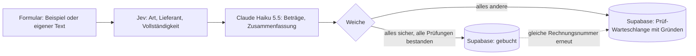

# Intelligent Document Processing

[English version](README.md) · [Projektseite](https://intelligentdocumentprocessing.speedofthespirit.dev)

> **Live-Vorführung:** https://danielironhack247-idp.hf.space/form/rechnungseingang
> Die Vorführung läuft auf einem Hugging-Face-Space. War sie zwei Tage unbenutzt, weckt der
> erste Aufruf den Server, das kann **bis zu zwei Minuten** dauern. Danach antwortet
> jeder Aufruf in wenigen Sekunden.

In einem Kreditoren-Postfach landen Rechnungen, aber auch Gutschriften, Mahnungen, Lieferscheine,
Verträge, Quittungen, Kontoauszüge, gewöhnliche E-Mails und gelegentlich ein Betrugsversuch. Diese
Verarbeitung bucht eine Rechnung nur, wenn jede Entscheidung sicher ist und jede Prüfung besteht.
Alles andere geht mit Begründung an einen Menschen.

- **Jev** (TypeSafe) trifft die festen Entscheidungen: Dokumentart, Lieferant, formale
  Vollständigkeit. Jev erzeugt keinen Text, sondern wählt eine Antwort und nennt kalibrierte
  Wahrscheinlichkeiten.
- **Claude Haiku 5.5** liest die Beträge aus und schreibt eine Zusammenfassung in zwei Sätzen.
- **Gewöhnlicher Programmcode** prüft, ob Netto plus Steuer Brutto ergibt und ob es den Steuersatz
  in Deutschland gibt.
- **PostgreSQL** (Supabase) verweigert, dieselbe Rechnung zweimal zu buchen.
- **n8n** steuert die Schritte und stellt das öffentliche Formular bereit.

## Ergebnisse auf 250 Dokumenten

| System | Weiche richtig | Fälschlich freigegeben | Unnötig zur Prüfung | Dokumentart | Lieferant | Formprüfung | Bruttobetrag | Antwortzeit Median | Antwortzeit 95 % | Kosten je 1.000 Dokumente | Ausfälle |
|---|---|---|---|---|---|---|---|---|---|---|---|
| Claude Sonnet 5.5 | 100,0 % | 0 | 0 | 100,0 % | 100,0 % | 98,4 % | 100,0 % | 3.601 ms | 4.704 ms | 10,12 $ | 0 |
| DeepSeek V4 Pro | 100,0 % | 0 | 0 | 99,6 % | 99,6 % | 96,4 % | 100,0 % | 20.245 ms | 49.026 ms | 7,10 $ | 1 |
| GPT-5.6 Terra | 98,4 % | 4 | 0 | 100,0 % | 100,0 % | 90,8 % | 100,0 % | 2.210 ms | 2.823 ms | 5,14 $ | 0 |
| GPT-5.6 Luna | 98,0 % | 5 | 0 | 100,0 % | 100,0 % | 89,6 % | 100,0 % | 2.271 ms | 3.479 ms | 0,55 $ | 0 |
| Jev + Claude Haiku 5.5 (hybrid) | 97,2 % | 0 | 7 | 100,0 % | 99,6 % | 93,6 % | 100,0 % | 1.977 ms | 2.803 ms | 0,39 $ | 0 |
| Mistral Small 3.1 24B | 96,0 % | 10 | 0 | 100,0 % | 100,0 % | 86,4 % | 98,1 % | 4.799 ms | 9.051 ms | 0,71 $ | 0 |
| Llama 3.3 70B | 94,8 % | 13 | 0 | 100,0 % | 98,4 % | 88,0 % | 95,2 % | 5.478 ms | 7.540 ms | 0,89 $ | 0 |
| Claude Haiku 5.5 | 94,0 % | 1 | 14 | 100,0 % | 100,0 % | 89,6 % | 100,0 % | 2.492 ms | 3.307 ms | 0,52 $ | 0 |

Gemessen am 8. Oktober 2026; jede Zahl stammt aus `results/summary.json`.

- **Keine fehlerhafte Rechnung gebucht.** Nur drei Systeme haben nie eine Rechnung freigegeben, die zu einem Menschen gehört hätte: Claude Sonnet 5.5, DeepSeek V4 Pro und der Hybrid aus Jev und Haiku. Der Hybrid ist **26-mal günstiger als Sonnet** und **18-mal günstiger als DeepSeek** und antwortet schneller als beide.
- **Am günstigsten von allen acht:** 0,39 $ je 1.000 Dokumente.
- **Jev entscheidet in 338 ms** (Median; 95 % der Aufrufe unter 446 ms). Der Gesamt-Median von 1977 ms ist die Zeit, die Haiku zum Auslesen der Beträge braucht.
- **Der Preis der Vorsicht:** Der Hybrid hat 7 von 250 Dokumenten zur Prüfung geschickt, die hätten gebucht werden können, sechs davon Tabellenexporte oder XRechnungen, bei denen Jev bei der Vollständigkeit unsicherer war. Eine unnötige Prüfung kostet eine Minute, eine falsch bezahlte Rechnung kostet Geld.
- **Wo andere danebenlagen:** GPT-5.6 Terra und Luna haben 4 bzw. 5 Rechnungen ohne Umsatzsteuer-ID freigegeben. Llama 3.3 hat 13 fehlerhafte Rechnungen freigegeben, fünf davon, weil es falsche Summen beim Auslesen stillschweigend korrigiert hat.
- DeepSeek hat bei 7 Dokumenten eine leere Antwort geliefert und wurde einmal erneut gefragt; 1 blieb leer und zählt als Ausfall.

## Wie ein Dokument entschieden wird



Eine Rechnung wird nur gebucht, wenn **alle** Bedingungen erfüllt sind:

| Prüfung | Durch | Regel |
|---|---|---|
| Dokument ist eine Rechnung | Jev, Auswahlfrage | Art `invoice`, Sicherheit ≥ 0,85 |
| Lieferant steht in den Stammdaten | Jev, Auswahlfrage | einer von 15 Lieferanten, Sicherheit ≥ 0,85 |
| Pflichtangaben nach § 14 Umsatzsteuergesetz vorhanden | Jev, Ja-Nein-Frage | Wahrscheinlichkeit ≥ 0,85 |
| Rechnungsnummer aufgedruckt | Haiku, Auslesen | nicht leer |
| Summen stimmen | Programmcode | Netto + Steuer = Brutto (±0,01), Steuer = Satz × Netto (±0,02) |
| Deutscher Steuersatz | Programmcode | 19 % oder 7 % |
| Noch nicht gebucht | Datenbank | Lieferant + Rechnungsnummer unter den gebuchten Rechnungen eindeutig |

Dieselben Schwellen, Anweisungen und Fragen steuern Messung und n8n-Ablauf:
`n8n/invoice_pipeline.workflow.json` wird aus dem Python-Paket erzeugt, und die automatische
Prüfung schlägt fehl, sobald beide auseinanderlaufen.

## Messverfahren

| Punkt | Einstellung |
|---|---|
| Testsatz | 250 künstliche Dokumente, Startwert 2026: 90 Rechnungen, 160 andere Dokumente aus 12 Arten |
| Formate | Brieftext, E-Mail, Scan mit Lesefehlern, Tabellenexport, Englisch, XRechnung |
| Eingebaute Rechnungsfehler | falsche Summe, fehlende Umsatzsteuer-ID, ausländischer Steuersatz, fehlende Rechnungsnummer, unbekannter Lieferant, Dublette |
| Richtige Antworten | für jedes Dokument bekannt, weil der Erzeuger jeden Fehler gezielt einbaut |
| Anweisung | eine gemeinsame Anweisung für alle Einzelmodelle; Haiku liest im Hybrid nur aus |
| Modelleinstellungen | Claude ohne erweitertes Nachdenken, GPT-5.6 mit `reasoning_effort=low` |
| Aufrufe | echte Anfragen, vier bis fünf gleichzeitig, von einem Cloud-Rechner im Oktober 2026 |
| Kosten | abgerechnete Token je Aufruf × Listenpreis vom 8. Oktober 2026 |
| Weiche | für alle Systeme gleich, angewendet auf die jeweils eigenen Antworten |

Grenzen: Der Testsatz ist künstlich, und alle Systeme haben die Dokumentarten richtig erkannt. Die
Unterschiede entstehen bei Vollständigkeit, Auslesen und Sicherheit. Jedes System lief einmal;
Antwortzeiten hängen von der Last beim Anbieter zu dieser Stunde ab. Die Vollständigkeitsfrage für
Jev wurde einmal an 15 Dokumenten des Testsatzes und den drei Vorführdokumenten formuliert und
danach nicht mehr geändert; die Anweisung der Einzelmodelle enthält dieselbe Frage.

## Selbst ausführen

```bash
uv sync
cp .env.example .env            # Schlüssel der gewünschten Anbieter eintragen
uv run idp corpus               # schreibt data/corpus.jsonl (250 Dokumente, Startwert 2026)
uv run idp benchmark --systems hybrid,haiku --limit 20
uv run idp report               # schreibt results/benchmark.md und results/summary.json
uv run pytest
```

`uv run idp benchmark` setzt dort fort, wo es aufgehört hat: beantwortete Dokumente werden
übersprungen, fehlgeschlagene wiederholt. `uv run idp workflow` erzeugt den n8n-Ablauf neu,
`uv run idp samples` schreibt die drei Vorführdokumente nach `samples/`.

## Betrieb

Supabase (kostenloser Tarif) als Speicher, ein Hugging-Face-Space für n8n (Docker-Spaces brauchen
seit Mitte 2026 ein PRO-Konto), Cloudflare Workers AI für Jev, Anthropic für Haiku. Hugging Face
erreicht `api.cloudflare.com` nicht, deshalb reicht die Projektseite auf Cloudflare Pages die
Jev-Anfragen von n8n unverändert weiter (`web/_worker.js`); ist diese Adresse nicht gesetzt, ruft der
Ablauf Cloudflare direkt auf. Schritt für Schritt: [Dokumentation/SETUP.de.md](Dokumentation/SETUP.de.md).
Datenbankschema: [sql/001_invoices.sql](sql/001_invoices.sql).

## Aufbau des Repositorys

| Pfad | Inhalt |
|---|---|
| `src/idp/` | Erzeuger des Testsatzes, Anbieter-Anschlüsse, Weiche, Messung, Bericht, Ablauf-Erzeuger |
| `n8n/` | erzeugter Ablauf zum Import in n8n |
| `sql/` | Supabase-Schema mit Lieferanten-Stammdaten, Dubletten-Prüfung und Zeilenschutz |
| `deploy/huggingface-space/` | Dockerfile für n8n auf einem Hugging-Face-Space |
| `data/` | der erzeugte Testsatz |
| `results/` | Rohantworten je System, `summary.json`, Vergleichstabellen |
| `web/` | Projektseite und Jev-Weiterleitung für n8n auf Hugging Face |
| `tests/` | Komponententests, nachgebildete Anbieter-Aufrufe, JavaScript-Weiche gegen Python geprüft |

Alle Lieferantendaten, Steuernummern und Bankverbindungen in diesem Repository sind erfunden.
Telekom und Amazon Web Services erscheinen nur namentlich, damit die Vorführdokumente echt wirken.

## Lizenz

MIT
