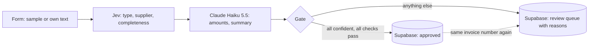

# Intelligent Document Processing

[Deutsche Fassung](README.de.md) · [Project page](https://intelligentdocumentprocessing.speedofthespirit.dev)

> **Live demo:** https://danielironhack247-idp.hf.space/form/rechnungseingang
> The demo runs on a Hugging Face Space. If nobody has used it for two days, the first
> request wakes the server, which can take **up to two minutes**. Every request after that
> answers within seconds.

An accounts-payable inbox receives invoices, but also credit notes, reminders, delivery notes,
contracts, receipts, bank statements, plain e-mails and the occasional scam. This pipeline books
an invoice only when every decision is confident and every check passes, and sends everything
else to a person with the reason attached.

- **Jev** (TypeSafe) makes the typed decisions: document type, supplier, formal completeness.
  It does not generate text; it returns a choice with calibrated probabilities.
- **Claude Haiku 5.5** reads the amounts and writes a two-sentence summary.
- **Plain code** checks that net plus tax equals gross and that the tax rate exists in Germany.
- **PostgreSQL** (Supabase) refuses to book the same invoice twice.
- **n8n** orchestrates the steps and serves the public form.

## Results on 250 documents

| System | Routing correct | Wrongly approved | Needless reviews | Doc type | Vendor | Completeness | Gross amount | Median latency | 95th pct latency | Cost per 1,000 docs | Failures |
|---|---|---|---|---|---|---|---|---|---|---|---|
| Claude Sonnet 5.5 | 100.0 % | 0 | 0 | 100.0 % | 100.0 % | 98.4 % | 100.0 % | 3,601 ms | 4,704 ms | $10.12 | 0 |
| DeepSeek V4 Pro | 100.0 % | 0 | 0 | 99.6 % | 99.6 % | 96.4 % | 100.0 % | 20,245 ms | 49,026 ms | $7.10 | 1 |
| GPT-5.6 Terra | 98.4 % | 4 | 0 | 100.0 % | 100.0 % | 90.8 % | 100.0 % | 2,210 ms | 2,823 ms | $5.14 | 0 |
| GPT-5.6 Luna | 98.0 % | 5 | 0 | 100.0 % | 100.0 % | 89.6 % | 100.0 % | 2,271 ms | 3,479 ms | $0.55 | 0 |
| Jev + Claude Haiku 5.5 (hybrid) | 97.2 % | 0 | 7 | 100.0 % | 99.6 % | 93.6 % | 100.0 % | 1,977 ms | 2,803 ms | $0.39 | 0 |
| Mistral Small 3.1 24B | 96.0 % | 10 | 0 | 100.0 % | 100.0 % | 86.4 % | 98.1 % | 4,799 ms | 9,051 ms | $0.71 | 0 |
| Llama 3.3 70B | 94.8 % | 13 | 0 | 100.0 % | 98.4 % | 88.0 % | 95.2 % | 5,478 ms | 7,540 ms | $0.89 | 0 |
| Claude Haiku 5.5 | 94.0 % | 1 | 14 | 100.0 % | 100.0 % | 89.6 % | 100.0 % | 2,492 ms | 3,307 ms | $0.52 | 0 |

Measured on 8 October 2026; every number comes from `results/summary.json`.

- **No faulty invoice booked.** Only three systems never approved an invoice that should have gone to a person: Claude Sonnet 5.5, DeepSeek V4 Pro and the Jev + Haiku hybrid. The hybrid costs **26× less than Sonnet** and **18× less than DeepSeek** and answers faster than both.
- **Cheapest of all eight:** $0.39 per 1,000 documents.
- **Jev decides in 338 ms** (median; 95 % of calls under 446 ms). The end-to-end median of 1977 ms is Haiku reading the amounts.
- **The price of caution:** the hybrid sent 7 of 250 documents to review that could have been booked, six of them table exports or XRechnung XML, where Jev was less sure about completeness. A needless review costs a minute; a wrongly paid invoice costs money.
- **Where others slipped:** GPT-5.6 Terra and Luna approved 4 and 5 invoices without VAT ID. Llama 3.3 approved 13 faulty invoices, five of them because it silently corrected wrong totals while reading them.
- DeepSeek returned an empty answer for 7 documents and was asked again once; 1 stayed empty and counts as a failure.

## How a document is decided



An invoice is approved only if **all** of these hold:

| Check | Done by | Rule |
|---|---|---|
| Document is an invoice | Jev choice | type `invoice`, confidence ≥ 0.85 |
| Supplier is in master data | Jev choice | one of 15 suppliers, confidence ≥ 0.85 |
| Mandatory fields present (section 14 German VAT Act) | Jev yes/no question | probability ≥ 0.85 |
| Invoice number printed | Haiku extraction | not empty |
| Totals add up | code | net + tax = gross (±0.01), tax = rate × net (±0.02) |
| German tax rate | code | 19 % or 7 % |
| Not booked before | database trigger | supplier + invoice number unique among approved invoices |

The same thresholds, prompts and questions drive the benchmark and the n8n workflow:
`n8n/invoice_pipeline.workflow.json` is generated from the Python package, and CI fails if the
two drift apart.

## Benchmark method

| Aspect | Setting |
|---|---|
| Corpus | 250 synthetic documents, seed 2026: 90 invoices, 160 other documents of 12 types |
| Formats | letter text, e-mail, scan with recognition errors, table export, English, XRechnung XML |
| Planted invoice faults | wrong sum, missing VAT ID, foreign tax rate, missing invoice number, unknown supplier, duplicate |
| Ground truth | known for every document, because the generator plants each fault deliberately |
| Prompt | one shared system prompt for all single-model systems; Haiku in the hybrid only extracts |
| Model settings | no extended thinking for Claude, `reasoning_effort=low` for GPT-5.6 |
| Calls | live requests, four to five in parallel, from a cloud VM in October 2026 |
| Cost | tokens billed per call × list price on 8 October 2026 |
| Gate | identical for every system, applied to each system's own answers |

Limitations: the corpus is synthetic and every system classified the document types correctly,
so the differences come from completeness, extraction and confidence. One run per system; latency
depends on provider load at that hour. The completeness question for Jev was worded once on 15
corpus documents and the three demo documents, then frozen; the single-model prompt contains the same question.

## Run it yourself

```bash
uv sync
cp .env.example .env            # add the keys for the providers you want to run
uv run idp corpus               # writes data/corpus.jsonl (250 documents, seed 2026)
uv run idp benchmark --systems hybrid,haiku --limit 20
uv run idp report               # writes results/benchmark.md and results/summary.json
uv run pytest
```

`uv run idp benchmark` resumes where it stopped: answered documents are skipped, failed ones are
retried. `uv run idp workflow` regenerates the n8n workflow, `uv run idp samples` writes the three
demo documents to `samples/`.

## Deployment

Supabase (free tier) for storage, a Hugging Face Space for n8n (Docker Spaces need a PRO account
since mid-2026), Cloudflare Workers AI for Jev, Anthropic for Haiku. Step by step: [Dokumentation/SETUP.md](Dokumentation/SETUP.md). Database
schema: [sql/001_invoices.sql](sql/001_invoices.sql).

## Repository layout

| Path | Content |
|---|---|
| `src/idp/` | corpus generator, provider clients, gate, benchmark, report, workflow builder |
| `n8n/` | generated workflow for import into n8n |
| `sql/` | Supabase schema with supplier master data, duplicate trigger and row level security |
| `deploy/huggingface-space/` | Dockerfile for n8n on a Hugging Face Space |
| `data/` | the generated corpus |
| `results/` | raw answers per system, `summary.json`, comparison tables |
| `web/` | project page |
| `tests/` | unit tests, mocked provider calls, JavaScript gate checked against Python |

All supplier data, tax IDs and bank details in this repository are invented. Telekom and Amazon
Web Services appear by name only to make the demo documents realistic.

## License

MIT
